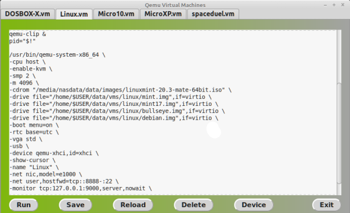

--------------------------------------------------------------------
qemu tools
--------------------------------------------------------------------


Tools to simplify qemu basic functions:

<li>qemu-mgr.py   - Python Gtk GUI to run/edit VM scripts.*
<li>qemu-mgr      - qemu-mgr.py background wrapper
<li>qemu-clip     - Automate clipboard send 
<li>qemu-winclip  - Experimental windows to linux clipboard
<li>qemu-mtr      - Bash qemu monitor plus drive change assist
<li>qemu-mount    - Assist mounting/umounting qemu img files
<li>qemu-tap      - Setup or remove bridge/tap
<li>qemu-start    - TUI qemu VM starter
<li>* example.vm (.vm scripts used by qemu-mgr)

To use the tools:

1.  Clone tools to a directory and make them executable.
qemu-mgr loads .vm scripts in its directory.
```
mkdir -p /home/$USER/data/qemu/
cd /home/$USER/data/qemu/
git clone https://github.com/KenH2000/qemu-tools.git
chmod +x /home/$USER/data/qemu/*
```
2.  Add symbolic links to a folder that is in $PATH.
```
echo "$PATH"
```
..shows..
/home/$USER/.local/bin:/usr/local/sbin: ...and so on...so /home/$USER/.local/bin/ is in $PATH.
```  
ln -s /home/$USER/data/qemu/qemu-clip /home/$USER/.local/bin/.    
ln -s /home/$USER/data/qemu/qemu-winclip /home/$USER/.local/bin/.
ln -s /home/$USER/data/qemu/qemu-mtr /home/$USER/.local/bin/.
ln -s /home/$USER/data/qemu/qemu-mount /home/$USER/.local/bin/.
ln -s /home/$USER/data/qemu/qemu-tap /home/$USER/.local/bin/. 
ln -s /home/$USER/data/qemu/qemu-mgr /home/$USER/.local/bin/.
ln -s /home/$USER/data/qemu/qemu-start /home/$USER/.local/bin/.
```
3.  Copy example_vm to your_name.vm and edit options as needed.  

-----------
example_vm
-----------
```
#!/bin/sh

#start clipboard sender 
qemu-clip &
pid="$!"

/usr/bin/qemu-system-x86_64 \
-cpu host \
-enable-kvm \
-smp 2 \
-m 4096 \
-cdrom "/media/nhtmlasdata/data/images/FD14LIVE.iso" \
-drive file="/home/$USER/data/vms/linux/mint.img",if=virtio \
-boot menu=on \
-vga std \
-show-cursor \
-name "Linux" \
-net nic,model=e1000 \
-net user,hostfwd=tcp::8888-:22 \
-monitor tcp:127.0.0.1:9000,server,nowait \

#stop clipboard sender
kill -9 "$pid"
```
------------

a. example_vm runs a qemu-clip process in the background.  
qemu-clip sends the clipboard over ssh.  The PID is saved.  

b. The VM runs with options to forward ssh and qemu monitor
over telnet for qemu-mtr.  

c.  After the machine is powered off, the script continues
and stops the the qemu-clip PID.

--------------------------------------------------------------------
qemu-mgr (qemu-mgr.py)
--------------------------------------------------------------------
GUI to run and edit qemu VM scripts.  qemu-mgr is a short 
script that runs qemu-mgr.py in the background.

--------------------------------------------------------------------
qemu-clip
--------------------------------------------------------------------
Send linux clipboard to guest. 
```
Usage: qemu-clip [-u user] [IP] [Port] [netcat]
```
With no arguments defaults to $USER@127.0.0.1:8888 over ssh.  

------------------------
qemu-clip Example 1 using ssh:
------------------------
To automatically start and stop the qemu-clip using ssh,
add the following to the .vm scripts 
<li>Guest needs openssh-server installed and passwordless login</li>

```
#---------------------------
#start clipboard sender 
qemu-clip & 
pid="$!"

/usr/bin/qemu-system-x86_64 \
...other options...
-net user,hostfwd=tcp::8888-:22 \
...other options...

#stop clipboard sender
kill -9 "$pid"
#---------------------------
```
------------------------
qemu-clip Example 2 using netcat:
------------------------
If ssh fails on the guest, try 
netcat to send the clipboard.
 1. Run as qemu-clip netcat 
 2. hostfwd as shown in .vm script. 
 3. Run netcat script on guest.

```
#---------------------------
#start clipboard sender 
qemu-clip netcat &
pid="$!"

/usr/bin/qemu-system-x86_64 \
#...other options...
-net user,hostfwd=tcp::8888-:8888 \
#...other options...

#stop clipboard sender
kill -9 "$pid"
#---------------------------
```

--------------------
netcat guest scripts
--------------------
```
------------------------
|     linux guest      |
------------------------
#!/bin/bash
while true;do
netcat -l 8888|xsel -ib
done
------------------------
|    windows guest     |
------------------------
:a
ncat -l 8888 | clip
goto a
------------------------
|    WinXP guest       |
------------------------
|requires cb.exe,nc.exe|
------------------------
:a
nc -l 8888 | cb
goto a
------------------------
```
--------------------------------------------------------------------
qemu-winclip
--------------------------------------------------------------------
Send a windows clipboard to linux guest.  EXPERIMENTAL
```
USAGE: qemu-winclip
```                             
--------------------------------------------------------------------
qemu-mtr
--------------------------------------------------------------------
Qemu monitor wrapper for bash (plus drive change assist)
```
Usage:  qemu-mtr [ip] [port]
```
Add option to redirect monitor in .vm script:
```
-monitor tcp:127.0.0.1:9000,server,nowait \
```
The monitor can also be redirected using -chardev option: 
```
-chardev socket,id=m1,host=127.0.0.1,port=9000,server=on,wait=off \
-mon chardev=m1,mode=readline \
```
--------------------------------------------------------------------
qemu-mount
--------------------------------------------------------------------
Script to simplify mount/umount nbd images.
```
Usage:  qemu-mount <imagefile> <mountpoint>
        qemu-mount -u <mountpoint>(optional)
 ```
--------------------------------------------------------------------
qemu-tap
--------------------------------------------------------------------
Adds or removes network bridge and tap.
```
Usage: qemu-tap
```
Options added in .vm script to use tap0:
```
-netdev tap,id=mynet0,ifname=tap0,script=no,downscript=no \
-device e1000,netdev=mynet0,mac=52:55:00:d1:55:01 \
```

--------------------------------------------------------------------
Use With Other Emulators
--------------------------------------------------------------------
Example .vm script to start a Dosbox emulator 
```
#!/bin/bash
#VM_DOSBOX-X

dosbox-x C /home/$USER/data/vms/dos/EMP10
```
